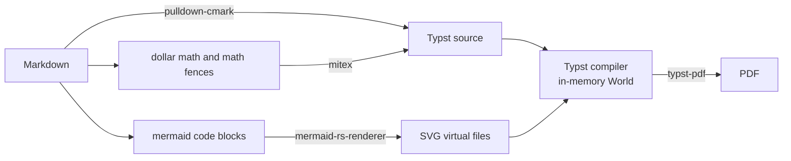

# md2pdf

[](https://github.com/turlapati/md2pdf/actions/workflows/ci.yml)
[](https://github.com/turlapati/md2pdf/releases/latest)

Convert GitHub-Flavored Markdown with LaTeX math and Mermaid diagrams to PDF —
as a VS Code extension or a single command-line binary. Everything is built in:
no Node, browser, LaTeX, Pandoc or system fonts required, and it works fully
offline.



## Features

* Headings with clickable in-document links, optional table of contents and heading numbering
* Bold, italic, strikethrough, inline code, links and local images (PNG, JPEG, GIF, SVG, WebP)
* Nested bullet and numbered lists, task lists, tables with column alignment
* Fenced and indented code blocks with syntax highlighting
* LaTeX math (`$…$`, `$$…$$`, and fenced `math` / `latex` / `tex` blocks)
* Mermaid diagrams (23 diagram types)
* Block quotes, GitHub alerts (`> [!NOTE]`, `[!TIP]`, `[!IMPORTANT]`, `[!WARNING]`, `[!CAUTION]`)
* Footnotes, definition lists, horizontal rules, `<br>` / `<sub>` / `<sup>` / `<kbd>`
* Document title from YAML front matter (`title:`) or the first heading
* A4 or US Letter paper

## Installation

Download from the [latest release](https://github.com/turlapati/md2pdf/releases/latest):

| File | What it is |
|---|---|
| `md2pdf-<version>.vsix` | VS Code extension (works on Windows, macOS and Linux) |
| `md2pdf-<version>-win32-x64.exe` | Command-line tool for Windows |
| `md2pdf-<version>-linux-x64` | Command-line tool for Linux |
| `md2pdf-<version>-darwin-arm64` | Command-line tool for macOS (Apple Silicon) |
| `md2pdf-<version>-darwin-x64` | Command-line tool for macOS (Intel) |

**VS Code extension:** in Cursor and VSCodium, open the Extensions view and
search for **md2pdf**. In VS Code, press `Ctrl+Shift+P` (`Cmd+Shift+P` on
macOS), run **Extensions: Install from VSIX…**, and pick the downloaded `.vsix`
file.

**Command-line tool:** rename the file to `md2pdf` (`md2pdf.exe` on Windows) and
put it somewhere on your `PATH`. On macOS and Linux, make it executable with
`chmod +x md2pdf`.

## Using the VS Code extension

Open a Markdown file, then do any of the following:

* Click the PDF icon in the editor title bar
* Press `Ctrl+Shift+Alt+P` (`Cmd+Shift+Alt+P` on macOS)
* Right-click a `.md` file in the Explorer and choose **Export to PDF**
* Run **md2pdf: Export to PDF** from the Command Palette

The PDF is written next to the Markdown file and opened in your default viewer.
Unsaved edits are included. Any warnings (for example, a missing image) are
listed in the **md2pdf** output panel.

### Settings

| Setting | Default | Description |
|---|---|---|
| `md2pdf.paper` | `a4` | Paper size: `a4` or `letter` |
| `md2pdf.fontSize` | `10.5` | Body font size in points |
| `md2pdf.toc` | `false` | Insert a table of contents |
| `md2pdf.numberHeadings` | `false` | Number headings (1, 1.1, …) |
| `md2pdf.remoteImages` | `altText` | How `http(s)` images are handled — see [Remote images](#remote-images) |
| `md2pdf.outputDirectory` | *(empty)* | Folder for PDFs, relative to the Markdown file; empty means next to it |
| `md2pdf.openAfterExport` | `true` | Open the PDF after exporting |
| `md2pdf.exportOnSave` | `false` | Re-export every time a Markdown file is saved |
| `md2pdf.backend` | `wasm` | `wasm` runs inside VS Code; `native` runs the command-line tool (faster for very large documents) |
| `md2pdf.nativeBinaryPath` | *(empty)* | Path to the command-line tool when `backend` is `native` |

## Using the command-line tool

```sh
md2pdf notes.md                                   # writes notes.pdf
md2pdf notes.md -o out/notes.pdf --toc            # custom output path, with table of contents
md2pdf notes.md --paper letter --font-size 11
md2pdf README.md --remote-images embed            # download and embed http(s) images
cat notes.md | md2pdf - -o - > notes.pdf          # read stdin, write stdout
md2pdf --list-fonts                               # show available font families
```

| Option | Description |
|---|---|
| `-o, --output <PATH>` | Output file (default: input name with `.pdf`; `-` for stdout) |
| `--paper <a4\|letter>` | Paper size (default `a4`) |
| `--font-size <PT>` | Body font size in points (default `10.5`) |
| `--toc` | Insert a table of contents |
| `--number-headings` | Number headings (1, 1.1, …) |
| `--title <TEXT>` | Document title (default: front-matter `title:`, else the first heading) |
| `--body-font <NAME>` / `--mono-font <NAME>` | Font families for body text and code |
| `--font-dir <DIR>` | Load extra `.ttf` / `.otf` fonts from a folder |
| `--remote-images <alt-text\|embed>` | How `http(s)` images are handled (default `alt-text`) |
| `--date <YYYY-MM-DD>` | Document date for PDF metadata (default: today) |
| `--emit-typst` | Write the intermediate Typst source instead of a PDF |
| `--list-fonts` | List available font families and exit |
| `-q, --quiet` | Suppress warnings |

## Remote images

Images with an `http://` or `https://` address, such as status badges, are
handled according to `md2pdf.remoteImages` (VS Code) or `--remote-images` (CLI):

* **`altText` / `alt-text` (default)** — nothing is downloaded. The image's alt
  text is shown as a link to the image. For a linked image such as
  `[](https://ci.example.com)`, the alt text links to the
  outer address.
* **`embed`** — the image is downloaded (15-second timeout, 10 MB limit) and
  placed in the PDF. Images inside a link are drawn inline at text height, the
  way badges appear on GitHub. If a download fails, the alt text is used and a
  warning is shown.

## Known limitations

* Raw HTML is ignored, except `<br>`, `<sub>`, `<sup>`, `<kbd>`, and comments.
* Links to other local files appear as plain text, since they can't be followed inside a PDF.
* The built-in fonts cover Latin, Greek and Cyrillic. For Chinese, Japanese,
  Korean or emoji, add a suitable font with `--font-dir`.
* Mermaid diagrams are drawn by a separate renderer, so they look close to, but
  not identical to, GitHub's.

## Building from source

See [CONTRIBUTING.md](CONTRIBUTING.md).

## License

[MIT](LICENSE)
