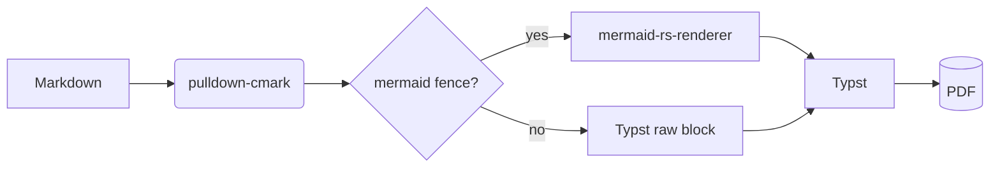
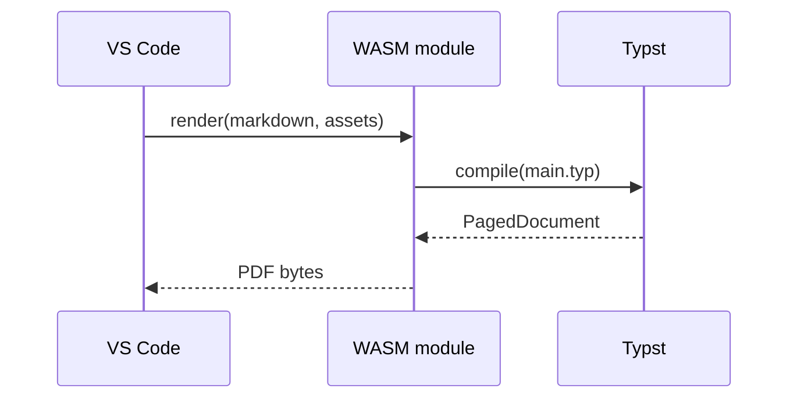
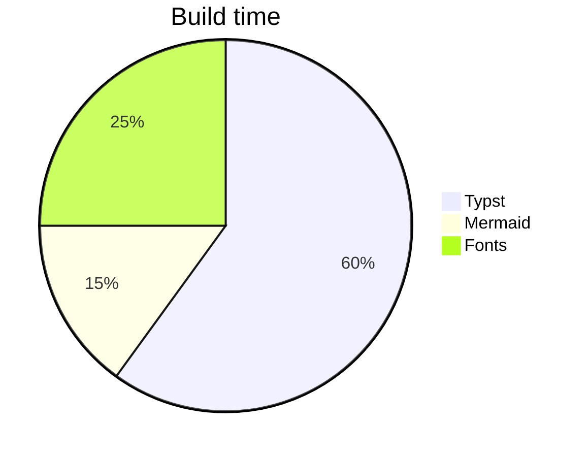

# md2pdf Kitchen Sink

This document exercises every construct the compiler supports. Links to
sections work: see [Tables](#tables) and [Mermaid diagrams](#mermaid-diagrams).

## Inline formatting

Plain, **bold**, *italic*, ***both***, ~~strikethrough~~, `inline code`,
a [link to Typst](https://typst.app), an autolink <https://github.com>, and
footnotes[^1]. Hard line break follows.  
Second line after the break.

Hostile characters that must render literally: # hash, @ at, [brackets],
*stars*, \_underscores\_, \$dollar\$, <angle>, ~tilde, -- double dash,
--- triple dash, // slashes, a raw URL https://example.com/path?q=1, a
backslash \ here, and "smart" 'quotes'.

[^1]: This is the footnote text, with **bold** and `code`.

## Lists

- Bullet one
- Bullet two with a nested list
  - Nested A
  - Nested B
    1. Deep ordered
    2. Deep ordered two
- Bullet three

3. Ordered starting at three
4. Four

- [ ] Open task
- [x] Completed task
- [ ] Another open task with `code`

A loose list:

- First paragraph of item one.

  Second paragraph of item one.

- Item two.

## Block quote

> Quoted text. It can span
> multiple lines and contain **formatting**.
>
> Second paragraph of the quote.

> [!NOTE]
> GitHub alerts are supported: NOTE, TIP, IMPORTANT, WARNING, CAUTION.

> [!WARNING]
> Raw HTML inside Markdown is dropped.

## Code

```rust
fn main() {
    // A triple backtick inside a code block: ```
    let s = "quotes \" and backslashes \\";
    println!("{s}");
}
```

```python
def fib(n: int) -> int:
    return n if n < 2 else fib(n - 1) + fib(n - 2)
```

```sql
SELECT trade_id, notional FROM trades WHERE book = 'EQ-DERIV' ORDER BY 2 DESC;
```

An indented code block:

    indented code
    still code

## Tables

| Column | Left | Center | Right |
|--------|:-----|:------:|------:|
| Row 1 | `code` | **bold** | 1,234.56 |
| Row 2 | [link](https://example.com) | *em* | 7 |
| A very long cell that should wrap gracefully within the available column width | x | y | 42 |

## Mermaid diagrams







A deliberately broken diagram must degrade gracefully, not abort the build:

```mermaid
notADiagramType
    A --> B
```

## Images

Local image: 

Missing image: 

Remote image (skipped, no network): 

## Horizontal rule and HTML

---

Raw HTML like <span style="color:red">this</span> is dropped, but a `<br>`<br>works as a line break.

<!-- an HTML comment, dropped silently -->

## Definition list

Term one
: Definition of term one.

Term two
: Definition of term two.

### Deeply nested heading (H3)

#### H4

##### H5

###### H6 — the end.
